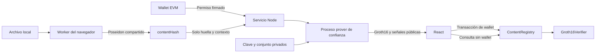
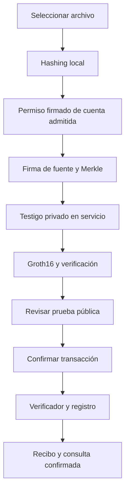
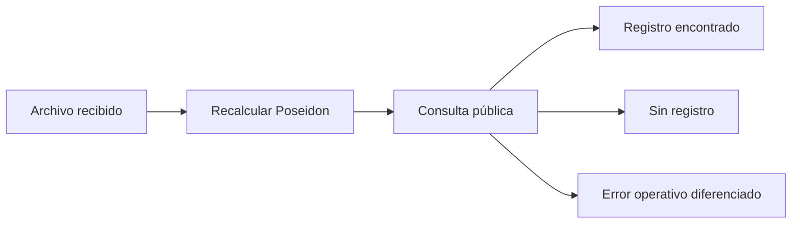

# Traza — Autenticidad multimedia

## Descripción general

Traza reúne las tres fases del proyecto: huellas Poseidon y firmas EdDSA/BabyJubJub; árboles Merkle, Groth16 y registro EVM; y una aplicación React para operar el protocolo desde el navegador. Permite registrar imágenes, audio y video mediante autorizaciones criptográficas y consultar posteriormente sus bytes exactos.

## Abrir y utilizar el sistema sin comandos

Requisito: Node.js 22.13 o posterior instalado. La primera preparación necesita Internet para npm, GitHub y solc.

1. Abre la carpeta del proyecto en el Explorador de Windows y haz doble clic en **Abrir Traza.cmd**.
2. El navegador mostrará las etapas reales de preparación. El lanzador instala dependencias cuando faltan, comprueba Groth16, construye contratos y web e inicia el servicio. También inicia un nodo local si hace falta.
3. La aplicación se abre normalmente en **http://127.0.0.1:5173**. Si ya estaba funcionando, se abre esa instancia.
4. Pulsa **Usar cuenta experimental** para ensayar con una cuenta del nodo local, o **Conectar wallet** para usar una extensión EVM.
5. En **Administración**, acepta el entorno experimental y pulsa **Preparar sistema local**. Se crean una fuente de desarrollo, contratos reales y la raíz autorizada.
6. Utiliza **Registrar contenido** o **Verificar contenido**. La administración de fuentes, permisos, raíces y propiedad, junto con las métricas, está disponible en el sitio.

La cuenta experimental utiliza firmas y transacciones reales de las cuentas desbloqueadas del nodo de desarrollo. Sus claves EVM y las claves privadas EdDSA permanecen fuera del navegador. El selector permite ensayar otras cuentas: inicialmente la cuenta 1 administra y puede solicitar autorizaciones. Las demás requieren permiso explícito. Este acceso experimental no está disponible en Amoy.

Cerrar la pestaña no detiene el servicio. Administración ofrece **Detener sistema local**. El lanzador cierra únicamente los procesos que inició y conserva un nodo preexistente. Hardhat mantiene la cadena en memoria: detener su nodo elimina ese estado. La siguiente apertura detecta contratos ausentes y permite preparar otro despliegue desde el sitio. Los informes JSON no restauran la cadena.

## Elegir red y desplegar con MetaMask

Abre la aplicación en **Chrome**, donde está instalada MetaMask. El selector **Red del protocolo** permite alternar entre **Red local** y **Polygon Amoy**. Las direcciones, claves de fuente, permisos y registros de despliegue se conservan por separado. Cambiar de red descarta la cuenta experimental local y las operaciones visuales pendientes; cada firma o transacción vuelve a comprobar la cuenta y cadena de la wallet.

Para utilizar Amoy desde el sitio:

1. Selecciona **Polygon Amoy** en la barra superior.
2. Pulsa **Conectar wallet** y acepta la conexión en MetaMask. Si hay otra cadena activa, usa **Cambiar de red** o acepta la solicitud de cambio al comenzar el despliegue.
3. Consigue **POL de prueba** para pagar el gas de Amoy en el [faucet indicado por Polygon](https://faucet.polygon.technology/).
4. Abre **Administración**. Acepta expresamente la fuente y ceremonia de desarrollo y pulsa **Desplegar contratos con mi wallet**.
5. Confirma por separado las tres transacciones: **Verifier**, **Registry** y **raíz autorizada**. MetaMask muestra el gas y conserva la clave privada. También se firman permisos para preparar y guardar el resultado.
6. El sitio verifica las transacciones de creación, los bytecodes, el propietario, la raíz y el contexto antes de guardar `deployments/80002/amoy.json` y activar la firma para esa wallet.
7. Ya puedes registrar y consultar archivos en Amoy. Volver a **Red local** recupera su despliegue previo y permite utilizar otra vez la cuenta experimental local.

Si rechazas una transacción intermedia, utiliza **Continuar despliegue** desde la misma cuenta y red. Las referencias confirmadas se conservan en la sesión para no repetir contratos ya creados. El nuevo despliegue queda conectado al sitio únicamente después de comprobar sus tres etapas. La fuente privada permanece en el servidor y no se exporta la clave de MetaMask.

Antes de cada transacción, el sitio estima el gas de los datos exactos y la cuenta conectada, añade un 20 % de margen y lo acota al límite del bloque. Envía ese límite explícito a MetaMask tanto al desplegar como al registrar y administrar. Las comisiones por unidad de gas siguen mostrándose en la wallet. Si ocurre un error, el aviso permanece en la página e identifica la etapa interrumpida del despliegue.

Datos de Amoy: cadena **80002**, moneda de gas **POL**, RPC público `https://polygon-amoy.drpc.org` y [explorador Amoy PolygonScan](https://amoy.polygonscan.com/). [Referencia oficial de Polygon](https://docs.polygon.technology/pos/reference/rpc-endpoints).

El asistente y su recuperación se validan con transacciones, contratos y pruebas reales en una cadena local aislada. La comprobación externa automática se limita al RPC de lectura: no se afirma un despliegue en Amoy sin confirmaciones de la wallet del usuario.
## Objetivos y alcance

Demostrar el recorrido completo desde un archivo hasta su autorización, pertenencia privada y registro confirmado; permitir consultas posteriores sin generar otra ZKP; y administrar el conjunto de confianza mediante operaciones reales. La fuente firmante y el registrante EVM son entidades independientes.

## Qué demuestra el prototipo

Un registro acredita que una clave incluida en el conjunto autorizado firmó esa huella y contexto, y que el contrato aceptó la prueba. La consulta vincula los bytes exactos del archivo recibido con ese registro.

## Qué NO demuestra el prototipo

No establece la veracidad de una escena, no clasifica contenido generado por IA ni es un detector universal de deepfakes. La ausencia de registro no demuestra falsedad o manipulación. Un error RPC significa que la consulta no pudo completarse. La confianza depende de la admisión de fuentes y de la protección de su administración.

## Arquitectura general



Un solo origen sirve UI, API y proxy RPC de lectura. La configuración proviene del despliegue y del contrato, no de direcciones copiadas entre componentes. El prover se ejecuta en un proceso Node dedicado: el circuito tiene 16 324 restricciones y el testigo contiene identidades que deben permanecer privadas frente al registrante. El proceso separado evita bloquear la API y el conflicto de trabajadores anidados de las dependencias.

## Tecnologías utilizadas

Versiones instaladas en la validación; `package-lock.json` fija la instalación reproducible.

| Componente | Versión |
| --- | --- |
| Node.js / npm | 26.13.0 / 11.20.0; Node mínimo 22.13.0 |
| React / React DOM | 19.3.1 / 19.3.1 |
| Vite / plugin React | 8.3.5 / 6.1.2 |
| TypeScript / tsx | 6.0.3 / 4.23.13 |
| Playwright | 1.64.1 |
| circom2 / compilador WASM | 0.2.23 / Circom 2.2.3 |
| circomlib / circomlibjs / snarkjs | 2.0.5 / 0.1.7 / 0.7.6 |
| Hardhat / toolbox viem / viem | 3.17.0 / 5.0.7 / 2.56.8 |
| Solidity / destino EVM / forge-std | 0.8.34 / Paris / 1.16.2 |

Se eligieron React, TypeScript y Vite porque no existía frontend y el repositorio ya utilizaba Node, TypeScript y viem. Se conservan las bibliotecas criptográficas y contratos de Fase 2. El navegador importa exclusivamente Poseidon WASM de circomlibjs, evitando utilidades Node de firma y claves en el bundle.

## Estructura del repositorio

```text
Abrir Traza.cmd             Entrada gráfica de escritorio
web/
  index.html, tsconfig.json
  src/
    App.tsx                Navegación, cuenta y cadena
    Register.tsx           Registro y comprobantes públicos
    Verify.tsx             Consulta sin wallet
    Admin.tsx              Preparación, fuentes, permisos y propiedad
    Deployment.tsx         Despliegue y recuperación mediante wallet
    components.tsx         Archivos, mensajes y resultados
    services.ts            Hashing, permisos, prover y EVM
    hash.worker.ts         Bytes locales por bloques
    types.ts, errors.ts, styles.css
server/
  app.ts                   API, autorización y trabajos
  security.ts              Desafíos y límites
  runtime.ts               Configuración privada y preparación
  prover-worker.mjs        EdDSA y Groth16 en proceso aislado
  validation.ts            Build y pruebas desde la web
  wallet-deployment.ts     Planes privados y comprobación de recibos
src/
  content-hash.mjs          Algoritmo único para Node y navegador
  hashing.mjs              Lectura estable de archivos locales
  poseidon.mjs, encoding.mjs
  key-management.mjs, eddsa.mjs, authorization.mjs
  protocol.mjs, merkle.mjs, zkp.mjs, blockchain.ts
circuits/content-authenticity.circom
contracts/ContentRegistry.sol
contracts/Groth16Verifier.sol
scripts/
  start-web.ps1, start-web.mjs, web-cli.ts, e2e-stack.mjs
  crypto-cli.mjs, sources-cli.mjs, zk-cli.mjs, blockchain-cli.ts
test/                      Módulos, API e integración EVM
e2e/web.spec.ts             Recorridos completos de navegador
samples/imagen-prueba.svg   Multimedia pública de ensayo
deployments/<chainId>/      Despliegues e historial reales
metrics/baseline-local.json Referencia medida de Fase 2
.local-web/                Claves, configuración y diagnósticos privados
.zk-artifacts/v1/          Artefactos grandes, excluidos de Git
```

Los archivos propios tienen descripción inicial y comentarios en español. La licencia y matemática del verificador generado se conservan. No se modifican archivos de plantilla ajenos a la integración.

## Procesamiento de contenido multimedia

La interfaz admite imágenes, audio y video de hasta 25 MiB. El archivo no se recodifica ni se sube. Un worker lee fragmentos de 64 KiB y utiliza el mismo `src/content-hash.mjs` que Node. Solo el hashing muestra porcentaje de bytes realmente procesados; las otras tareas muestran etapas. Las vistas previas usan URLs temporales liberadas al cambiar el archivo.

Cambiar de archivo cancela el procesamiento anterior. Cambiar de cuenta invalida la autorización preparada y conserva el hashing independiente de la wallet.

## ContentHash con Poseidon

Se conserva el algoritmo de Fase 1: bloques de 31 bytes, último bloque incompleto con ceros a la derecha, entero big-endian y estado inicial igual a la longitud original. Cada bloque actualiza el estado mediante Poseidon de dos entradas. Un múltiplo de 31 no recibe otro bloque. El archivo vacío produce `Poseidon(0, 0)`.

Campo: `p = 21888242871839275222246405745257275088548364400416034343698204186575808495617`. Se utilizan BigInt y cadenas decimales canónicas. Se rechazan Number, valores negativos, valores fuera de rango y reducciones silenciosas. La lectura Node detecta cambios del archivo durante el procesamiento.

## Firma EdDSA/BabyJubJub

Se utilizan `prv2pub`, `signPoseidon` y `verifyPoseidon` de circomlibjs. Claves públicas y R8 contienen dos coordenadas; S debe ser un escalar canónico. Las APIs validan curva, subgrupo y rechazo del punto neutro. Se firma el elemento de campo, no su texto decimal. Claves Ed25519/PEM son incompatibles.

## Autorización criptográfica

```text
authorizationHash = Poseidon(contentHash, protocolVersion, sourceId, nonce)
operationContext = Poseidon(registrant, chainId, registryAddress, protocolDomain)
signedAuthorizationHash = Poseidon(authorizationHash, operationContext)
```

La fuente firma `signedAuthorizationHash`. Versión 1; dominio ASCII big-endian `zkp-content-authenticity:v1`, entero `50360535517347656596214192851187233225966461402695475318446782001`. El circuito exige direcciones de 160 bits, chainId positivo de 64 bits y sourceId positivo dentro del campo.

La solicitud web requiere un desafío EIP-191 vinculado a origen, cuenta, acción, compromiso del cuerpo, cadena, registro, identificador y vencimiento. Se consume una sola vez, se verifica su firma y se revalida el permiso. La política admite solicitudes de hashes de cuentas expresamente autorizadas por el administrador; no realiza revisión semántica del archivo.

## Gestión de claves

La semilla EdDSA de 32 bytes es independiente de la wallet EVM. Se genera con aleatoriedad criptográfica y se guarda en el servidor, con modo 0600, fuera del bundle, Git y el testigo. Crear o rotar una fuente nunca devuelve su clave privada al navegador. El almacenamiento local no está cifrado: protegerlo mediante permisos del sistema. JavaScript no garantiza el borrado completo de memoria.

`.env`, `.local-web/`, `keys/`, `output/`, `data/`, `.crypto-build/` y resultados de pruebas están excluidos de Git. La semilla pública de los vectores es exclusivamente de ensayo.

## Árbol de Merkle

```text
leaf = Poseidon(sourceId, publicKeyX, publicKeyY)
parent = Poseidon(izquierda, derecha)
```

Profundidad 8, capacidad 256, orden numérico ascendente por sourceId, duplicados rechazados y hojas vacías cero. Las rutas van de hoja a raíz: índice 0 para nodo actual izquierdo y 1 para derecho. El circuito exige índices booleanos y la raíz pública correcta.

## Fuentes autorizadas

Administración permite crear, rotar y revocar fuentes directamente desde el sitio. Primero se prepara una raíz candidata; la wallet propietaria la publica y el servicio sincroniza el conjunto privado solo después de comprobarla en cadena. Una fuente debe seguir incluida y disponer de una clave en el servicio para autorizar nuevos registros.

Existe una sola raíz activa. Sustituirla invalida la anterior; puede deshabilitarse y reactivarse desde el sitio. La revocación conserva el historial y no demuestra fraude retrospectivo. La propiedad exige propuesta y aceptación desde cuentas distintas.

## Privacidad de datos

| Dato | Participantes que lo utilizan |
| --- | --- |
| Archivo completo | Solo el dispositivo del usuario |
| contentHash y contexto | Navegador, servicio y blockchain |
| Permiso firmado por wallet | Navegador y servicio |
| sourceId, nonce, clave pública, firma EdDSA y ruta | Servicio/prover de confianza, dentro del testigo |
| Semilla privada de fuente | Servidor, fuera del testigo |
| Prueba y ocho señales públicas | Navegador y verificador EVM |
| Conjunto y permisos de emisión | Servidor y administración autenticada |

El conjunto solo se entrega al administrador por necesidad operativa. El prover devuelve prueba pública, señales, métricas y coordenadas Solidity. No se registran testigos o multimedia en logs del navegador. Los trabajos requieren tokens impredecibles en memoria y vencen a los diez minutos.

## Nullifier y protección anti-replay

```text
nullifier = Poseidon(sourceId, nonce, protocolVersion, chainId, registryAddress)
```

Nonce aleatorio no nulo de 248 bits, acotado por el circuito. La prueba exige igualdad con el nullifier calculado. El contrato lo consume solo tras validar todo y también impide duplicar contentHash. Copiar una prueba no permite cambiar registrante, cadena o registro.

## Circuitos Circom

`content-authenticity.circom` reconstruye autorización, contexto y mensaje, impone `EdDSAPoseidonVerifier.enabled = 1`, y valida Merkle y nullifier. Tiene 16 324 restricciones, ocho entradas públicas, 23 elementos privados y ninguna salida.

```text
[contentHash, protocolVersion, authorizedSourcesRoot, nullifier,
 registrant, chainId, registryAddress, protocolDomain]
```

Entradas privadas: sourceId, nonce, publicKeyX/Y, R8x/y, S y dos rutas de ocho elementos. Los hashes de autorización se calculan internamente. La prueba autoriza una huella; el hashing de los bytes ocurre fuera del circuito y se repite durante la consulta.

## Generación de ZKP

El frontend llama a `generateRegistrationProof(config, contentHash, onStage, signal)`. La API autentica la solicitud y un proceso aislado carga la clave, firma, reconstruye Merkle, genera el testigo en memoria, produce Groth16 y verifica su resultado. Los estados reflejan esas etapas reales. La UI solicita después la transacción del registrante. La cola, desafíos y cuerpos JSON tienen límites; los trabajos pueden cancelarse.

## Groth16

Circom 2, circomlib y snarkjs sobre BN254. La verification key tiene exactamente ocho señales públicas. El exportador conserva el orden de coordenadas Solidity; no se intercambia manualmente `pi_b`.

## Solidity Verifier

Se exporta `Groth16Verifier.sol` desde la zkey final, preservando matemática y licencia. El registro mantiene una referencia inmutable al verificador.

## Registry Contract

`ContentRegistry` comprueba campo canónico, versión, dominio, raíz habilitada, `registrant == msg.sender`, `chainId == block.chainid`, dirección del registro, duplicados, nullifier y Groth16. Después consume la autorización y conserva huella, versión, cuenta, fecha y existencia. Los rechazos no modifican estado. Sus eventos son públicos; `getRecord` no requiere ZKP. No hay admisión administrativa que omita la prueba.

## Configuración blockchain

Se mantienen Hardhat 3, viem, hardhatMainnet, hardhatOp y sepolia, además de localhost y la conexión Amoy de Fase 2. Se comprueba chainId real, bytecode, artifactId y configuración del contrato. Las direcciones provienen de despliegues realmente ejecutados.

Amoy utiliza 80002 y el patrón de RPC/normalización de clave de `../blockchain-gr40-escrow`, adaptado a viem sin copiar contratos ni secretos. La web permite desplegar con MetaMask y también conservar un despliegue externo previamente configurado. Cada red mantiene su propio runtime privado. No se envían transacciones externas automáticamente. Se comprobaron los despliegues locales y el RPC de Amoy; no se atribuye un despliegue en Amoy.

## Entorno blockchain local

El lanzador utiliza loopback y reutiliza el nodo disponible. La sesión de cuenta experimental solo permite permisos de esta aplicación y transacciones de valor cero al registro configurado o a las etapas exactas de un plan de despliegue autenticado; no entrega claves al cliente. La conexión con una extensión identifica cuenta/cadena, permite solicitar el cambio de red e interpreta rechazos de wallet.

## Despliegue de contratos

**Administración → Preparar sistema local** despliega ambos contratos, espera recibos y publica la raíz. Guarda transacciones, direcciones, artifactId y hashes del código. El historial público se organiza en `deployments/<chainId>/`; las pruebas E2E guardan sus despliegues dentro de su directorio aislado.

## Aplicación web

Navegación: Inicio, Registrar contenido, Verificar contenido, Administración y Cómo funciona. Incluye diseño adaptable, teclado, previsualización, estados de carga y clasificación de errores. Los servicios tipados separan archivo, autorización, prover y EVM de los componentes.

## Flujo de registro



## Flujo de verificación



La consulta no necesita wallet, semilla, testigo ni otra prueba. Un resultado positivo muestra huella, versión, fecha, registrante, red y contrato. El registro muestra su transacción al confirmarse.

## Administración de fuentes

El propietario autentica el acceso al conjunto, crea/rota/revoca fuentes, publica y sincroniza raíces, deshabilita/reactiva registros y edita los permisos de emisión. También propone o acepta la transferencia de administración. Los controles visuales se complementan con autorización en API y contrato.

## Requisitos previos

Windows para el lanzador y Node compatible. La preparación inicial requiere npm/GitHub. El validador prepara Chromium oficial de Playwright si falta. El ensayo local no requiere Circom global, Rust, una wallet externa o fondos de testnet.

## Instalación de dependencias

El lanzador instala lo necesario. Se verificó una instalación limpia con `npm ci`, una ceremonia nueva, compilación, firmas y pruebas reales. No se reemplazó el stack criptográfico para introducir el frontend.

## Variables de entorno

El uso local se prepara desde el sitio. `.env.example` contiene opciones de operación y configuración externa; `.env` queda fuera del frontend y Git.

| Variable | Uso |
| --- | --- |
| RPC_URL / CHAIN_ID | Nodo local, predeterminados 127.0.0.1:8545 y 31337 |
| BLOCKCHAIN_NETWORK / AMOY_RPC_URL | Red del servicio y proveedor Amoy; localhost por defecto |
| DEPLOYER_PRIVATE_KEY | Clave EVM externa, independiente de EdDSA |
| VERIFIER_ADDRESS / REGISTRY_ADDRESS | Opcionales; deben coincidir con el despliegue guardado |
| AUTHORIZATION_ROOT | Raíz decimal opcional para herramientas |
| SOURCE_EDDSA_PRIVATE_KEY | Alternativa de semilla en CLI de Fase 1 |
| WEB_PORT / WEB_ORIGIN | 5173 y http://127.0.0.1:5173 por defecto |
| WEB_DEPLOYMENT_FILE | Archivo real consumido por el servicio |
| WEB_SIGNING_ENABLED | `true` habilita explícitamente firma fuera de la preparación local |
| WEB_ALLOWED_REGISTRANTS | Direcciones admitidas separadas por comas |
| WEB_SOURCE_ID / WEB_SOURCE_KEY_FILE / WEB_SOURCES_FILE | Fuente y archivos privados del servicio |
| WEB_PUBLIC_RPC_URL | RPC público para la wallet; sin secretos del proveedor |
| WEB_BOOTSTRAP_ADMIN | Cuenta inicial autorizada expresamente por el operador |
| WEB_DATA_DIRECTORY | Directorio privado alternativo, utilizado para aislar E2E |

No utilizar prefijos `VITE_` para secretos. El navegador consulta un proxy de lectura; las credenciales RPC permanecen en el servidor. El servicio escucha en loopback. Una infraestructura externa requiere transporte y política de operación apropiados.

## Construcción del proyecto

El lanzador y el validador compilan Solidity, comprueban TypeScript y construyen `web/dist`. El build web no necesita claves. Default y production fijan EVM Paris; production conserva el optimizador de 200 ejecuciones. Las métricas de referencia utilizan default.

## Comandos disponibles

Referencia técnica para desarrollo; **el recorrido gráfico no requiere ejecutar estos comandos**.

| Comando | Descripción | Requisitos | Resultado esperado |
| --- | --- | --- | --- |
| `npm ci` | Dependencias fijadas | Node e Internet inicial | Instalación completa |
| `npm run build` | Solidity, TS y frontend | Dependencias | Artefactos y web/dist |
| `npm test` | Módulos y contratos | Dependencias | 108 pruebas |
| `npm run crypto:test` | Fase 1 | Dependencias | 38 aprobadas |
| `npm run crypto:hash -- --file archivo` | Poseidon de bytes exactos | Archivo estable | Huella decimal |
| `npm run crypto:keygen` | Claves de fuente | Rutas nuevas | Archivos privado y público |
| `npm run crypto:authorization -- --file archivo --operation operacion.json --out salida.json` | Construye autorización | Operación canónica | JSON de relaciones |
| `npm run crypto:sign -- --file archivo --operation operacion.json --key clave.json --out firma.json` | Firma EdDSA | Semilla | Paquete firmado |
| `npm run crypto:verify -- --file archivo --operation operacion.json --authorization firma.json --public-key publica.json` | Verificación de fuente | Clave/operación de confianza | valid true/false |
| `npm run zk:compile` | Compila circuito | Dependencias | R1CS, WASM y símbolos |
| `npm run zk:setup` | Setup o comprobación | Dependencias | PTau, claves, verificador y manifiesto |
| `npm run zk:verifier` | Comprueba exportación | Setup | Ruta, hash y artifactId |
| `npm run zk:sources -- --help` | build/add/update/revoke/proof/verify | Conjunto | Ayuda ejecutable |
| `npm run zk:inputs -- --authorization firma.json --membership ruta.json --out entradas.json` | Evidencia a entradas | Firma y pertenencia | JSON privado |
| `npm run zk:witness -- --input entradas.json --out testigo.wtns` | Exportación explícita | Setup y entradas | Testigo privado |
| `npm run zk:prove -- --input entradas.json --out prueba.json` | Groth16 real | Setup y entradas | Paquete público |
| `npm run zk:verify -- --input prueba.json` | Verifica Groth16 | Artefactos correspondientes | valid true/false |
| `npm run zk:test` | Circuito y Merkle | Dependencias | 30 aprobadas |
| `npm run zk:demo -- --file samples/imagen-prueba.svg` | Ensayo aislado Fase 2 | Dependencias | Informe y success true |
| `npm run chain:node` | Nodo local | Dependencias | RPC 8545 |
| `npm run chain:deploy -- --network localhost --sources fuentes.json` | Despliega y publica raíz | RPC y wallet | Despliegue confirmado |
| `npm run chain:root -- --network localhost --sources fuentes.json` | Cambia root | Propietario | Root confirmado |
| `npm run chain:disable-root -- --network localhost` | Suspende registros | Propietario | Root deshabilitado |
| `npm run chain:config -- --network localhost` | Configuración efectiva | RPC y despliegue | Datos públicos |
| `npm run chain:check -- --network localhost` | Código y correspondencia | RPC y artefactos | valid true |
| `npm run chain:operation -- --network localhost --source-id 1 --out operacion.json` | Contexto real y nonce | RPC y despliegue | Operación privada |
| `npm run chain:register -- --network localhost --input prueba.json` | Transacción de registro | Prueba y wallet | Recibo |
| `npm run chain:query -- --network localhost --file archivo` | Consulta bytes | RPC y despliegue | Registro o exists false |
| `npm run chain:test` | Integración EVM Fase 2 | Dependencias | 7 aprobadas |
| `npm run web:launch` | Equivalente al lanzador | Node | Navegador y servicios |
| `npm run web:dev` | API y Vite | RPC y artefactos | Servicio de desarrollo |
| `npm run web:start` | API y build | RPC, artefactos y build | Servicio local |
| `npm run web:prepare -- --experimental` | Preparación local alternativa | RPC local | Fuente y contratos |
| `npm run web:build` | Frontend de producción | Dependencias | web/dist |
| `npm run web:test` | Clientes y API real | Artefactos | 17 aprobadas |
| `npm run web:e2e` | Chromium y contratos reales | Build y Chromium | 9 aprobadas |

Los hooks previos de test, despliegue y demo preparan lo necesario. Los CLI admiten `--help`. Las salidas privadas no sobrescriben resultados anteriores. Verificación inválida: código 2; error de ejecución/formato: 1; éxito: 0. Una consulta con exists false es correcta.

## Compilación de circuitos

El compilador WASM fijado genera R1CS, WASM, símbolos y estadísticas. La instancia principal deriva de los parámetros del protocolo y comprueba ocho señales públicas y cero salidas. No requiere Circom global y usa rutas nativas de Node en Windows.

## Generación de witness

El sitio genera el testigo en memoria, sin guardarlo ni entregarlo al registrante. `zk:witness` permite exportarlo únicamente de forma explícita. La semilla privada no es una entrada. Las pruebas alteran directamente el WASM para comprobar restricciones, además de validaciones JavaScript.

## Setup Groth16

Powers of Tau local de potencia 14, una contribución aleatoria de desarrollo, fase dos y otra contribución específica Groth16. Se comprueban PTau y zkey contra R1CS antes de exportar. Procede de una ejecución local y un participante; no acredita una ceremonia distribuida de producción.

El manifiesto vincula parámetros, herramientas, compilador, circomlib y hashes de circuito, R1CS, WASM, símbolos, PTau, zkey, vkey y verificador. `artifactId` identifica el conjunto. SHA-256 identifica artefactos; la multimedia usa Poseidon. Los archivos grandes no se versionan.

`zk:setup -- --force` regenera claves y verificador y requiere compilar, desplegar y generar pruebas nuevas. `--resume` comprueba PTau/zkey existentes y documenta su recuperación; no combinar opciones. Se usan archivos en memoria para evitar una fuga de descriptor de snarkjs 0.7.6 en la comprobación de H bajo Node 26, sin cambiar sus ecuaciones.

## Generación y verificación de pruebas

La UI solicita permiso, muestra las etapas y permite revisar prueba y métricas antes de confirmar. Las APIs `generateProof` y `verifyProof` siguen disponibles para consumidores independientes. El contrato vuelve a verificar la prueba; la validación del cliente no sustituye la admisión en cadena.

## Compilación de contratos

Se compila antes del chequeo TypeScript para usar tipos de ABI actualizados. La API obtiene el ABI del artefacto Hardhat; los componentes no mantienen copias manuales. Se construyen el verificador, registro y pruebas Solidity.

## Tests de contratos

Las 16 pruebas Solidity cubren administración, raíces, rangos, contexto y estado inalterado al fallar. Las 7 integraciones EVM añaden Groth16 real, aceptación, duplicados, nullifier consumido, copia por otra cuenta, otra cadena/contrato y revocación con historial.

## Despliegue local

Se ejecuta desde Administración con direcciones y recibos reales. El sitio detecta un nodo reiniciado o un verificador incompatible y permite otra preparación; no presenta un archivo JSON histórico como contrato disponible.

## Inicio de servicios

El lanzador muestra etapas antes de iniciar la aplicación, reutiliza el nodo disponible y escucha en loopback. Si falla la preparación, muestra reintento y conserva `.local-web/startup.log`. Los servicios E2E usan puertos y datos independientes.

## Inicio de la aplicación web

Abrir **Abrir Traza.cmd** o la URL local mientras esté activa. No hace falta iniciar manualmente frontend, prover y backend en terminales separadas.

## Ejemplo completo de registro

1. Abre Traza, elige la cuenta experimental 1 y prepara el sistema si falta.
2. En Registrar contenido, selecciona `samples/imagen-prueba.svg` o una foto propia.
3. Revisa nombre, formato, tamaño, vista previa y contentHash.
4. Pulsa Preparar prueba y confirma el permiso si utilizas una extensión.
5. Espera autorización, testigo, Groth16 y verificación.
6. Pulsa Confirmar registro y acepta la transacción.
7. Comprueba Registro encontrado; revisa transacción, métricas y comprobante descargable.

## Ejemplo completo de verificación

1. Abre Verificar contenido sin conectar una wallet.
2. Selecciona el mismo archivo registrado: el resultado debe ser Registro encontrado.
3. Modifica una copia y consulta esa copia: su huella será distinta y normalmente no tendrá registro.
4. Una falla del nodo se presenta como error operativo separado.

Registrar una foto distinta con una autorización nueva es legítimo. La prueba de alteración consiste en consultar el archivo modificado contra el registro existente, no en volver a autorizarlo.

## Tests unitarios

Vectores de frontera, firma determinista, contexto, secretos y CLI de Fase 1; Merkle, vacíos, rutas y revocación; y clientes web, formato, wallet, cadena y errores. Los dobles se limitan a casos unitarios o a simular una caída RPC para comprobar su clasificación visual.

## Tests de integración

La API se prueba con firmas EVM, Groth16 y contratos reales. Comprueba permisos, origen, RPC de escritura bloqueado, firma falsa, modificación de datos, replay, privacidad de respuestas, tokens, duplicados, raíces confirmadas y suspensión de emisión.

## Pruebas end-to-end

Resultado de la validación web: **17 pruebas de servicio/cliente y 9 E2E de navegador aprobadas**. Chromium selecciona una imagen, compara su hash con Node, obtiene autorización, genera Groth16, registra y consulta. También comprueba alteración, consulta sin wallet, error RPC, duplicado, fuentes, permisos, cuenta no autorizada, transferencia de propiedad y diseño móvil. El despliegue y su recuperación se ejecutan con una wallet que rechaza solicitudes sin límite explícito de gas o con un límite excesivo.

Los E2E usan cadena 18545, servicio 5174 y directorios exclusivos bajo `.crypto-build/`. No reemplazan firmas ni contratos y no alteran fuentes del usuario. Capturas y trazas se excluyen de Git.

Desde la terminal, ejecuta `npm run build`, `npm test`, `npm run web:test` y `npm run web:e2e`. Instala Chromium con `npx playwright install chromium` si hace falta.

## Métricas

Cada prueba muestra tiempos de testigo, generación, verificación y tamaño JSON; el recibo conserva gas y bloque. Administración expone restricciones, compilación/setup, herramientas, artifactId y confianza. El sitio permite descargar comprobantes y reportes.

Referencia de Fase 2 en `metrics/baseline-local.json`: 16 324 restricciones, testigo 84,75 ms, prueba 301,38 ms, verificación 6,55 ms, JSON 722 bytes, verificador 263 846 gas y registro 410 717 gas. Es una medición identificada, no una garantía. Los informes nuevos van a `metrics/runs/`.

Las coordenadas ABI ocupan 256 bytes sin señales ni selector. `proofBytes` mide JSON. El gas real procede de recibos y la estimación RPC se distingue. La confirmación local no representa finalidad o latencia de Amoy.

## Modelo de seguridad

El permiso de wallet autentica y limita la solicitud; no reemplaza firma de fuente ni ZKP. Desafíos de dos minutos, cuerpos JSON de hasta 128 KiB, cuotas y cola limitada; trabajos con expiración. Las escrituras exigen origen configurado y el proxy permite solo lectura. El contrato comprueba contexto y uso único. La administración no puede registrar sin prueba. El modo experimental es explícito y no se habilita automáticamente en redes externas.

## Modelo de privacidad

El servicio recibe huella y contexto y conoce el testigo: es un componente de confianza. El archivo completo permanece en el dispositivo. El registrante recibe la prueba, no la evidencia privada de fuente. La blockchain conserva solo datos públicos previstos. Estas garantías no eliminan correlación por metadatos, tiempos o información externa.

## Limitaciones

Setup local de desarrollo, emisión basada en cuentas admitidas, claves locales sin cifrar y nodo Hardhat volátil. No se realiza detección forense universal. La descarga inicial incluye Poseidon/WASM y puede tardar más. Amoy necesita despliegue y operación reales; no se atribuyen resultados externos no ejecutados.

## Troubleshooting

| Situación | Acción |
| --- | --- |
| No abre el lanzador | Verificar Node 22.13 o posterior y abrir nuevamente Abrir Traza.cmd |
| Preparación fallida | Revisar etapa, pulsar Reintentar preparación y consultar startup.log si hace falta |
| Wallet no encontrada | Usar cuenta experimental o una extensión EVM compatible |
| Otra red | Pulsar Cambiar de red y confirmar en la wallet |
| Cuenta desconectada/cambiada | Conectar la elegida y preparar otra autorización |
| Nodo reiniciado o contrato ausente | Preparar el sistema nuevamente desde Administración |
| Cuenta sin permiso | Admitir su dirección desde Permisos de emisión |
| Archivo ya registrado | Consultarlo en Verificar contenido |
| Nullifier usado | Solicitar autorización nueva, sin reutilizar la prueba |
| Root deshabilitado | El propietario puede habilitarlo desde el sitio |
| Root cambiado | Sincronizar el conjunto confirmado y generar otra prueba |
| Firma, ruta o testigo fallidos | Revisar conjunto, clave disponible y correspondencia de artefactos |
| WASM, proving key o vkey incompatibles | No mezclar ceremonias; revisar el diagnóstico de preparación y validación |
| Artefactos regenerados | Preparar un nuevo despliegue y pruebas correspondientes |
| RPC no disponible | Revisar el nodo; no interpretar el error como Sin registro |
| Rechazo de wallet o transacción revertida | Revisar el error específico y confirmar cuando se desee |
| Sin fuente con clave disponible | Crear una fuente y publicar/sincronizar su raíz desde Administración |
| Falta de fondos externos | Financiar la wallet en la red configurada; el ensayo local no requiere fondos externos |

Referencias: [Circom](https://docs.circom.io/), [circomlibjs](https://github.com/iden3/circomlibjs/tree/v0.1.7), [circomlib](https://github.com/iden3/circomlib/tree/v2.0.5), [snarkjs](https://github.com/iden3/snarkjs), [Hardhat](https://hardhat.org/llms.txt), [viem](https://viem.sh/llms.txt), [Vite](https://vite.dev/guide/), [RPC Polygon](https://docs.polygon.technology/pos/reference/rpc-endpoints).
