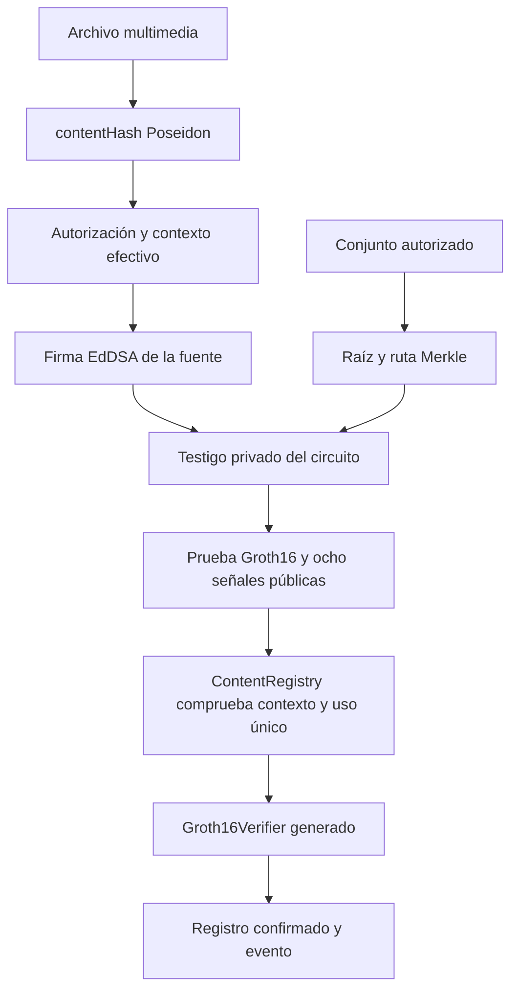
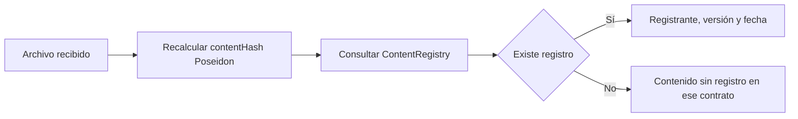

# Autenticidad multimedia — Fases 1 y 2

Autenticación de archivos mediante Poseidon, firmas EdDSA/BabyJubJub, pertenencia a un conjunto de fuentes autorizadas y pruebas Groth16 verificadas por un registro EVM. La fuente firma fuera de cadena; el registro acepta el contenido cuando la prueba y su contexto cumplen las reglas del protocolo.

El proyecto usa Hardhat 3 y viem. Funciona localmente sin credenciales externas y tiene conexión configurable con Polygon Amoy. Esta fase deja módulos y comandos para una futura interfaz web.

## Ejecutar el ensayo completo

Desde la raíz del proyecto, con Node y npm instalados:

```shell
npm ci
npm run zk:setup
npm run build
npm test
npm run zk:demo
```

`zk:demo` calcula la huella de `samples/prueba.txt`, genera una fuente temporal, construye el árbol, despliega ambos contratos, firma, genera una prueba real, la registra y consulta el archivo. Usa una cadena Hardhat aislada que termina al cerrar el comando. Devuelve `success: true` y guarda un informe en `metrics/runs/demo-<fecha>.json`. Puede repetirse sin administrar claves ni iniciar un nodo aparte.

Para ensayar otro archivo:

```shell
npm run zk:demo -- --file samples/prueba-modificada.txt
```

La primera instalación requiere acceso a npm, GitHub por `forge-std` y la descarga de solc por Hardhat. Después, el setup local, las firmas, el prover y los ensayos Hardhat funcionan sin una testnet externa. El setup tarda más que una generación de prueba.

## Herramientas y archivos

Las versiones instaladas en la validación son las siguientes; `package-lock.json` fija la instalación reproducible con `npm ci`.

| Herramienta | Versión |
| --- | --- |
| Node.js / npm | 26.13.0 / 11.20.0; Node mínimo 22.13.0 |
| circom2 / compilador Circom WASM | 0.2.23 / 2.2.3 |
| circomlib / circomlibjs | 2.0.5 / 0.1.7 |
| snarkjs | 0.7.6 |
| Hardhat / toolbox viem | 3.17.0 / 5.0.7 |
| viem / TypeScript / tsx | 2.56.8 / 6.0.3 / 4.23.13 |
| Solidity / destino EVM | 0.8.34 / Paris |
| forge-std | 1.16.2 |

No es necesario instalar Circom globalmente ni compilar Rust. El adaptador usa el compilador WASM incluido en `circom2` y rutas nativas de Node para Windows. Solidity conserva los perfiles default y production; ambos fijan Paris para evitar depender de instrucciones EVM más recientes. Production conserva el optimizador de 200 ejecuciones. Las mediciones incluidas utilizan el perfil default.

```text
src/
  hashing.mjs              Huella Poseidon de archivos, bytes y streams
  poseidon.mjs             Instancia Poseidon compartida
  encoding.mjs             Campo, direcciones y JSON canónico
  key-management.mjs       Semillas EdDSA y carga de secretos
  eddsa.mjs                Claves públicas y firmas BabyJubJub
  authorization.mjs        Autorización y firma vinculada al contexto
  protocol.mjs             Versión, dominio, rangos, nonce y nullifier
  merkle.mjs               Conjunto autorizado, árbol y rutas
  zkp.mjs                  Compilación, setup, testigo, prover y verificación
  blockchain.ts            Despliegues, registro, consultas y mediciones
circuits/
  content-authenticity.circom
contracts/
  Groth16Verifier.sol      Generado por snarkjs
  ContentRegistry.sol      Reglas de registro y administración de raíces
scripts/
  crypto-cli.mjs           Hash, claves, autorización, firma y verificación
  sources-cli.mjs          Altas, cambios, bajas y rutas Merkle
  zk-cli.mjs               Operaciones del circuito y Groth16
  blockchain-cli.ts        Despliegue, raíz, registro, consulta y ensayo
test/
  *.test.mjs               Fase 1, Merkle y restricciones del circuito
  blockchain.test.ts      Integración real y E2E
  ContentRegistry.t.sol    Pruebas unitarias del contrato
  vectors/crypto-v1.json   Vectores criptográficos de ensayo
deployments/<chainId>/     Último despliegue e historial público por red
metrics/baseline-local.json  Medición local conservada como referencia
metrics/runs/              Informes nuevos, excluidos de Git
.zk-artifacts/v1/          R1CS, WASM, claves, Powers of Tau y manifiesto
keys/, output/, data/      Material local excluido de Git
```

Los archivos de plantilla ajenos a esta integración se conservan. Los módulos propios tienen descripciones y comentarios en español. El verificador exportado mantiene la licencia, los comentarios y la matemática del generador.

## Relación demostrada y arquitectura



El circuito reconstruye exactamente estas relaciones de la primera fase:

```text
authorizationHash = Poseidon(contentHash, protocolVersion, sourceId, nonce)
operationContext = Poseidon(registrant, chainId, registryAddress, protocolDomain)
signedAuthorizationHash = Poseidon(authorizationHash, operationContext)
leaf = Poseidon(sourceId, publicKeyX, publicKeyY)
nullifier = Poseidon(sourceId, nonce, protocolVersion, chainId, registryAddress)
```

Comprueba la firma de `signedAuthorizationHash` con `EdDSAPoseidonVerifier`, cuyo `enabled` está fijado a 1. Reconstruye la hoja y sus ocho niveles Merkle hasta la raíz pública, y exige que el nullifier calculado coincida con el presentado. La firma se produce con `circomlibjs` fuera del circuito. No se utiliza Ed25519.

Orden exacto de `publicSignals`, compartido por el circuito, el prover y los contratos:

```text
[contentHash, protocolVersion, authorizedSourcesRoot, nullifier,
 registrant, chainId, registryAddress, protocolDomain]
```

| Clasificación | Valores |
| --- | --- |
| Público | Los ocho valores anteriores, la prueba Groth16 y la raíz autorizada |
| Privado en el testigo | sourceId, nonce, publicKeyX/Y, R8x/y, S, merklePathElements[8], merklePathIndices[8] |
| Calculado internamente | authorizationHash, operationContext y signedAuthorizationHash |
| Fuera del testigo | La semilla privada EdDSA y la clave de la billetera EVM |

El circuito tiene ocho entradas públicas, 23 elementos privados y ninguna salida. El hash del archivo se calcula fuera del circuito: la prueba demuestra la autorización de esa huella, y quien consulta un archivo debe recalcularla sobre sus bytes.

La blockchain conserva `contentHash`, versión, registrante, fecha y existencia, además del estado de nullifiers consumidos. No conserva la identidad de la fuente, su clave pública, la firma EdDSA ni la ruta Merkle. `ContentRegistered` emite solamente huella, registrante, versión y fecha.

### Huella y codificación de la Fase 1

Se procesan los bytes originales del archivo, sin interpretar el formato multimedia: bloques de 31 bytes, último bloque incompleto con ceros a la derecha, entero big-endian y estado inicial igual a la longitud original. Cada bloque actualiza el estado mediante Poseidon de dos entradas. Un múltiplo de 31 no recibe otro bloque. El archivo vacío es exactamente `Poseidon(0, 0)`. La lectura usa búferes de 64 KiB y detecta cambios del archivo durante el procesamiento.

El campo es `p = 21888242871839275222246405745257275088548364400416034343698204186575808495617`. Las APIs criptográficas reciben BigInt o cadenas decimales canónicas y rechazan `Number`, valores negativos, valores fuera del campo y reducciones silenciosas módulo p. En JSON se usan cadenas decimales; las direcciones del contexto usan `0x` y 40 dígitos hexadecimales, y el circuito recibe su entero de 160 bits.

La versión es 1 y el dominio es el entero big-endian del ASCII `zkp-content-authenticity:v1`: `50360535517347656596214192851187233225966461402695475318446782001`. El circuito limita `chainId` a un entero positivo de 64 bits, las direcciones a 160 bits y `sourceId` a un elemento de campo positivo. Las claves y firmas de las APIs se validan sobre BabyJubJub y su subgrupo; `S` debe ser canónico.

### Fuentes autorizadas y revocación

El administrador decide qué relación fuente-clave merece confianza. El árbol tiene profundidad 8 y capacidad 256: ordena las fuentes numéricamente por `sourceId` ascendente, rechaza identificadores repetidos y llena las posiciones restantes con hojas cero. Cada padre es `Poseidon(izquierda, derecha)`. Las rutas se exportan desde la hoja hacia la raíz; índice 0 significa nodo actual a la izquierda e índice 1 a la derecha. Los índices son booleanos también dentro del circuito.

`add`, `update` y `revoke` crean un conjunto nuevo. Al cambiar su contenido hay que publicar su nueva raíz y regenerar las rutas. El contrato admite **una sola raíz activa**: sustituirla invalida inmediatamente la anterior para registros nuevos. El propietario puede deshabilitarla o publicar otra; la propiedad se transfiere en dos pasos con aceptación del destinatario. No hay una función administrativa para registrar contenido sin prueba.

Una revocación conserva los registros históricos. No borra registros anteriores ni demuestra que fueran fraudulentos. El archivo del conjunto y las rutas deben distribuirse por un canal adecuado: publicar la relación fuente-clave fuera de la prueba puede revelar la identidad que se pretende ocultar en cadena.

### Uso único y contexto

`chain:operation` genera un nonce privado con 31 bytes aleatorios, distinto de cero y menor que `2^248`. El circuito impone ese rango. Su nullifier es público y queda consumido solo después de superar todas las validaciones. Reutilizar el nonce de la misma fuente, versión, cadena y registro produce el mismo nullifier, aunque se cambie el contenido.

El contrato comprueba los ocho elementos del campo, versión y dominio, raíz habilitada, `registrant == msg.sender`, `chainId == block.chainid`, dirección del registro, ausencia de contenido duplicado, nullifier disponible y verificación Groth16. Una prueba copiada por otra billetera falla por registrante; modificar ese dato invalida la prueba. Una prueba de otra cadena o contrato tampoco puede registrarse. Los intentos rechazados no crean registros ni consumen nullifiers.

## Compilación, setup y artefactos

```shell
npm run zk:compile
npm run zk:setup
npm run zk:verifier
npm run build
```

`zk:compile` produce R1CS, WASM, símbolos y estadísticas. `zk:setup` crea Powers of Tau de potencia 14 con una contribución local aleatoria, prepara su segunda fase, crea la clave Groth16, añade otra contribución, comprueba su correspondencia con R1CS y exporta `verification_key.json` y `contracts/Groth16Verifier.sol`. `zk:verifier` comprueba los artefactos y muestra la ruta y el hash del verificador ya exportado.

El Powers of Tau procede de esta ejecución local, con un participante. **Su nivel de confianza es de desarrollo**: no acredita una ceremonia distribuida ni debe presentarse como setup de producción. La entropía de las contribuciones no se imprime ni se guarda; esto tampoco convierte la ceremonia de una parte en una ceremonia de producción.

El manifiesto `.zk-artifacts/v1/manifest.json` vincula versión, dominio, profundidad, orden público, versiones de herramientas, hashes del compilador y de los circuitos de circomlib y SHA-256 de circuito, entrada principal, R1CS, WASM, símbolos, PTau, zkey, verification key y verificador Solidity. `artifactId` identifica ese conjunto. SHA-256 se usa para integridad de artefactos; la huella multimedia sigue usando Poseidon. Un despliegue conserva su `artifactId` y hashes del bytecode. `chain:check` contrasta el código del verificador con el compilado y comprueba la configuración del registro.

Con artefactos válidos, `zk:setup` solo los comprueba. Para regenerar deliberadamente:

```shell
npm run zk:setup -- --force
npm run build
```

Esto cambia las claves y el verificador: es necesario desplegar nuevamente y generar nuevas pruebas. No mezclar artefactos ni contratos de ceremonias diferentes. Si una ejecución se interrumpió pero ya existen PTau y zkey finales, `npm run zk:setup -- --resume` los comprueba contra el circuito antes de exportar y registra que su procedencia fue recuperada. No usar `--resume` junto con `--force`.

Los archivos grandes están excluidos de Git; un clon ejecuta su propia ceremonia de desarrollo. El verificador generado se mantiene separado del registro y no se edita su matemática. El adaptador evita una fuga de descriptor de snarkjs 0.7.6 en la comprobación de H usando archivos en memoria durante esa comprobación, compatible con Node 26; no modifica dependencias ni ecuaciones.

## Registro paso a paso en un nodo local

Estos comandos usan los módulos de la primera fase y el contexto real del despliegue. Los resultados y claves se crean sin sobrescribir: al repetirlos, elegir otros nombres o reutilizar conscientemente los archivos ya generados. Los nombres `phase2-*` se utilizaron en el ensayo de validación.

En una terminal, mantener el nodo abierto:

```shell
npm run chain:node
```

En otra terminal, desde el mismo proyecto:

```shell
npm run crypto:keygen -- --out keys/phase2-private.json --public-key keys/phase2-public.json
npm run zk:sources -- add --sources samples/sources-empty.json --source-id 1 --public-key keys/phase2-public.json --out output/phase2-sources.json
npm run zk:sources -- build --sources output/phase2-sources.json
npm run chain:deploy -- --network localhost --sources output/phase2-sources.json
npm run chain:config -- --network localhost
npm run chain:check -- --network localhost
```

El despliegue espera confirmaciones de Verifier y Registry y publica la raíz. Guarda direcciones y transacciones reales en `deployments/31337/localhost.json` y una copia en `history/`. Sin `--sources` ni raíz configurada, el despliegue deja el registro sin autorización habilitada hasta ejecutar `chain:root`.

Crear una operación con el identificador de cadena, la dirección de contrato, el dominio y la billetera efectiva; firmar el archivo y generar su prueba:

```shell
npm run chain:operation -- --network localhost --source-id 1 --out output/phase2-operation.json
npm run crypto:sign -- --file samples/prueba.txt --operation output/phase2-operation.json --key keys/phase2-private.json --out output/phase2-authorization.json
npm run zk:sources -- proof --sources output/phase2-sources.json --source-id 1 --out output/phase2-membership.json
npm run zk:sources -- verify --input output/phase2-membership.json
npm run zk:inputs -- --authorization output/phase2-authorization.json --membership output/phase2-membership.json --out output/phase2-inputs.json
npm run zk:witness -- --input output/phase2-inputs.json --out output/phase2-witness.wtns
npm run zk:prove -- --input output/phase2-inputs.json --out output/phase2-proof.json
npm run zk:verify -- --input output/phase2-proof.json
npm run chain:register -- --network localhost --input output/phase2-proof.json --out output/phase2-receipt.json
```

`zk:inputs` valida firma y pertenencia y añade el nullifier. El paquete, la ruta, las entradas y el `.wtns` contienen información privada del protocolo: conservarlos localmente. `zk:prove` genera su propio testigo en memoria, por lo que la exportación con `zk:witness` es opcional. El archivo de prueba contiene solamente prueba, señales públicas, identificador de artefactos, métricas y coordenadas preparadas para Solidity. El adaptador aplica el orden de `pi_b` requerido por snarkjs; no se debe intercambiar a mano.

La wallet que envía el registro debe ser el `registrant` firmado. `chain:operation` permite `--registrant 0x...` si otra billetera va a registrar; esa cuenta debe estar disponible en la conexión que envía la transacción. La muestra `samples/operation.json` pertenece a los vectores de Fase 1 y no reemplaza una operación leída del despliegue real.

### Consultar posteriormente



```shell
npm run chain:query -- --network localhost --file samples/prueba.txt
npm run chain:query -- --network localhost --file samples/prueba-modificada.txt
```

La primera consulta devuelve `record.exists: true`; la segunda devuelve `false` tras el ensayo anterior. También se admite `--hash <decimal>` en lugar de `--file`. La consulta usa un cliente público y no necesita semilla EdDSA, wallet, testigo ni una nueva ZKP.

El nodo local pierde el estado al cerrarse. Los JSON de despliegue no restauran la cadena. Después de reiniciarlo, desplegar nuevamente, crear una operación para el contrato efectivo y repetir el registro. El ensayo `zk:demo` utiliza su propia cadena y no deja un despliegue consultable por `localhost`.

### Administrar fuentes

```shell
npm run zk:sources -- update --sources output/phase2-sources.json --source-id 1 --public-key keys/phase2-public.json --out output/phase2-updated-sources.json
npm run chain:root -- --network localhost --sources output/phase2-updated-sources.json
npm run zk:sources -- revoke --sources output/phase2-updated-sources.json --source-id 1 --out output/phase2-revoked-sources.json
npm run chain:root -- --network localhost --sources output/phase2-revoked-sources.json
npm run chain:disable-root -- --network localhost
```

Para rotar una clave, `--public-key` debe señalar el nuevo archivo público. Actualizar con la misma clave conserva la raíz. `chain:root` acepta también `--root <decimal>` o `AUTHORIZATION_ROOT`; las opciones explícitas tienen prioridad. Publicar una raíz habilita ese conjunto. Estas operaciones requieren la wallet propietaria. Tras revocar, las fuentes restantes deben recibir sus nuevas rutas; los registros ya confirmados continúan disponibles.

## Variables y Polygon Amoy

Crear `.env` a partir de `.env.example` si todavía no existe y completar únicamente las variables necesarias. La configuración Hardhat carga `.env`; el CLI criptográfico de Fase 1 solo lo carga si Node recibe `--env-file=.env`. Mantener `SOURCE_EDDSA_PRIVATE_KEY` vacío al usar `--key` evita fuentes de secreto ambiguas.

| Variable | Uso |
| --- | --- |
| SOURCE_EDDSA_PRIVATE_KEY | Semilla de fuente de 32 bytes hexadecimales; alternativa a `--key` |
| BLOCKCHAIN_NETWORK | Red predeterminada; `localhost` si no se configura |
| RPC_URL / CHAIN_ID | Nodo local; valores predeterminados `http://127.0.0.1:8545` y 31337 |
| AMOY_RPC_URL | Proveedor de Polygon Amoy; valor público predeterminado `https://polygon-amoy.drpc.org` |
| DEPLOYER_PRIVATE_KEY | Clave EVM secp256k1 de 32 bytes, con o sin `0x`; independiente de la semilla EdDSA |
| VERIFIER_ADDRESS / REGISTRY_ADDRESS | Opcionales; deben coincidir con las direcciones del despliegue guardado de la red elegida |
| AUTHORIZATION_ROOT | Raíz Poseidon decimal opcional para despliegue o administración |

Los comandos admiten `--network` y `--deployment <archivo.json>`. Se comprueba que el identificador informado por el RPC coincide con la configuración. Amoy fija `chainId = 80002`; la variable `CHAIN_ID` se aplica a localhost. Las redes hardhatMainnet, hardhatOp y sepolia preexistentes se conservan.

La conexión toma como referencia la configuración de `../blockchain-gr40-escrow`: proveedor `AMOY_RPC_URL` y normalización de la clave EVM. Se adapta a Hardhat 3 y viem del proyecto actual, sin trasladar contratos escrow ni sus secretos. Aquí la clave EVM se denomina `DEPLOYER_PRIVATE_KEY`.

Para desplegar en Amoy, configurar el RPC y una wallet de desarrollo con POL de prueba y ejecutar:

```shell
npm run chain:deploy -- --network amoy --sources output/phase2-sources.json
npm run chain:config -- --network amoy
npm run chain:check -- --network amoy
npm run chain:operation -- --network amoy --source-id 1 --out output/amoy-operation.json
```

El archivo real quedará en `deployments/80002/amoy.json`. Repetir firma, ruta, entradas y prueba con esa operación y nombres de salida nuevos; luego usar `chain:register --network amoy` y `chain:query --network amoy`. Una prueba de localhost no se reutiliza en Amoy. Esta entrega comprobó los despliegues locales y consultó el RPC público de Amoy, que respondió `eth_chainId = 0x13882` (80002). No se ejecutó ni se atribuye un despliegue en Amoy.

Las consultas no necesitan `DEPLOYER_PRIVATE_KEY`. Dejar direcciones opcionales vacías permite utilizar directamente el archivo de despliegue. Si se completan, el programa exige coincidencia para evitar operar accidentalmente sobre otro contrato.

## Pruebas, métricas y límites

```shell
npm run crypto:test
npm run zk:test
npm run chain:test
npm test
```

La suite completa ejecutada pasó **91 pruebas: 16 Solidity y 75 Node**. Comprueba los vectores y comandos de Fase 1, Merkle, entradas privadas, firma y rutas alteradas, límites, señales públicas modificadas, pruebas Groth16 reales, integridad de artefactos, duplicados, nullifier consumido, copia por otro registrante, otra cadena o contrato, revocación, conservación histórica y ausencia de cambios de estado al fallar. El E2E usa los contratos y el verificador generado reales.

`metrics/baseline-local.json` conserva una medición local y su `artifactId`. `zk:demo` y el E2E generan nuevos informes en `metrics/runs/`. Las métricas incluyen restricciones y compilación, setup, hashing, testigo, generación de prueba, verificación local, tamaño de prueba, gas y confirmación. Los tiempos dependen del equipo y de la carga; no son una garantía de rendimiento.

| Medición local de referencia | Resultado |
| --- | --- |
| Restricciones / señales públicas / salidas | 16 324 / 8 / 0 |
| Compilación Circom / setup | 1 481,94 ms / 42 904,71 ms |
| Testigo / prueba / verificación fuera de cadena | 84,75 ms / 301,38 ms / 6,55 ms |
| Prueba JSON / coordenadas ABI | 722 bytes / 256 bytes |
| Gas del verificador / registro completo | 263 846 / 410 717 |
| Confirmación local del registro | 5,97 ms |

`proofBytes` mide el JSON de la prueba Groth16; `proofAbiBytes` mide las ocho coordenadas codificadas para Solidity, 256 bytes, sin señales públicas ni selector. `verifierGas` procede del recibo de una transacción de ensayo al verificador; `verifierGasEstimate` es la estimación RPC. `registrationGas` procede del recibo del registro e incluye su verificación interna. El ensayo realiza la transacción adicional del verificador para medirlo por separado. La confirmación local con minado automático no equivale a latencia o finalidad de Amoy.

La firma acredita la autorización de una huella por una clave incluida en el conjunto aprobado. La confianza depende de cómo el administrador admite fuentes y protege su wallet. No demuestra la veracidad del contenido, no evita todas las filtraciones por metadatos y no garantiza anonimato frente al conjunto conocido, el momento del registro o información externa. Las imágenes, audio o video que cambien de codificación también cambian sus bytes y huella.

Las claves y entradas privadas se guardan localmente sin cifrado. `.env`, `keys/`, `output/`, `data/`, testigos y artefactos grandes están excluidos de Git; utilizar también permisos adecuados del sistema y evitar publicar el conjunto de fuentes si debe mantenerse reservado. Las semillas públicas de `test/vectors/crypto-v1.json` son exclusivamente de ensayo. JavaScript no garantiza el borrado completo de secretos de memoria.

No se incluyen una interfaz web ni una ceremonia de producción. Las actualizaciones de dependencias deben volver a validar los vectores y los artefactos; el módulo ZKP rechaza versiones criptográficas diferentes de las comprobadas. `npm audit` permite consultar el estado actual del árbol de dependencias.

### Problemas habituales

| Problema | Acción |
| --- | --- |
| PowerShell bloquea npm.ps1 | Usar `npm.cmd` como alternativa; utilizar la política de scripts que corresponda al entorno. |
| EEXIST al crear resultados | Reutilizar el resultado existente o elegir otra ruta; los comandos no reemplazan claves. |
| Faltan artefactos | Ejecutar `npm run zk:setup` y después `npm run build`. |
| Artefacto incompatible o alterado | Revisar el cambio; regenerar con `zk:setup -- --force`, compilar, desplegar y probar de nuevo. |
| Registro sin código o check fallido tras reiniciar | Desplegar en el nodo que está funcionando; un archivo JSON no restaura sus contratos. |
| WrongRegistrant, WrongChain o WrongRegistry | Crear la operación con el despliegue y la cuenta efectivos y volver a firmar y probar. |
| UnauthorizedRoot | Consultar la raíz actual, obtener la pertenencia vigente y regenerar la prueba. |
| NullifierAlreadyUsed | Crear una autorización nueva con nonce aleatorio; no reutilizar la anterior. |
| ContentAlreadyRegistered | Consultar el registro existente; la misma huella solo se registra una vez por contrato. |
| Falta wallet o fondos en Amoy | Configurar la clave EVM y fondos de prueba; las consultas públicas no los requieren. |
| Direcciones de entorno no coinciden | Revisar VERIFIER_ADDRESS, REGISTRY_ADDRESS y el archivo de la red elegida. |
| Decimal o clave inválidos | Usar cadenas canónicas y semillas generadas por `crypto:keygen`; no usar PEM ni claves EVM para EdDSA. |
| valid: false | Comprobar archivo, clave de confianza, raíz, contexto y correspondencia de artefactos. |
| El archivo cambia durante el hashing | Procesar una copia estable del archivo. |

Las verificaciones inválidas devuelven código 2; los errores de ejecución o formato devuelven 1; el éxito devuelve 0. Una consulta con `exists: false` es una consulta correcta. Los cuatro CLI admiten `--help`.

Referencias de las implementaciones: [circomlibjs 0.1.7](https://github.com/iden3/circomlibjs/tree/v0.1.7), [EdDSAPoseidonVerifier](https://github.com/iden3/circomlib/blob/v2.0.5/circuits/eddsaposeidon.circom), [snarkjs](https://github.com/iden3/snarkjs), [Hardhat 3](https://hardhat.org/llms.txt), [viem](https://viem.sh/llms.txt), [configuración del compilador Solidity](https://docs.soliditylang.org/en/latest/using-the-compiler.html), [RPC de Polygon Amoy](https://docs.polygon.technology/pos/reference/rpc-endpoints).
